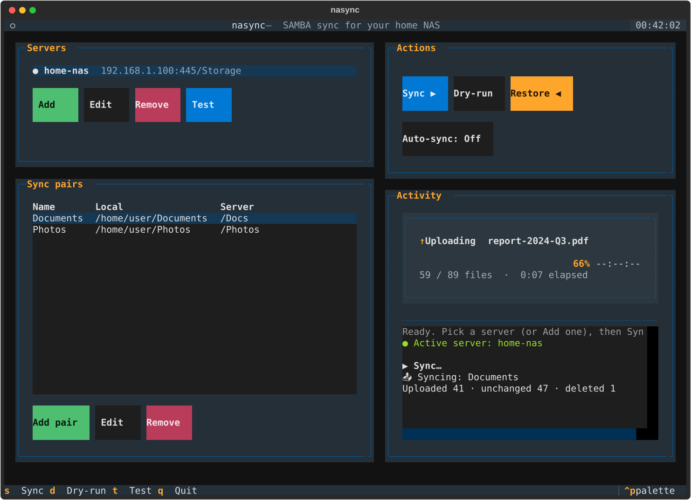

# nasync

A lightweight, cross-platform tool for syncing your local folders to a
SAMBA-based home NAS. Use it as a CLI, a full terminal UI (`nasync tui`), or a
launcher in your desktop app menu. Perfect for simple backup and file sync.

## Features

- 🔄 **Bidirectional Sync**: Push local changes to server or restore from backup
- 🎯 **Simple Configuration**: Guided `nasync setup` with a built-in connection test
- 🖱️ **Terminal UI**: A full-screen interface (`nasync tui`) — plus a clickable app icon
- ⚡ **Manual & Automatic Modes**: Sync on demand or auto-watch for file changes
- 🖥️ **Cross-Platform**: Works on Linux (Fedora, Ubuntu, etc.) and macOS
- 🔐 **Secure**: Credentials stored locally with restricted permissions
- 📦 **Lightweight**: Minimal dependencies, low memory footprint

## Installation

### From Source

```bash
git clone https://github.com/YuvalBogo/nasync.git
cd nasync
pip install -e .
```

### Via pip (when published)

```bash
pip install nasync           # CLI only
pip install 'nasync[tui]'    # CLI + interactive terminal UI (nasync tui)
```

## Quick Start

**⏱️ 5-minute setup guide:** See [QUICKSTART.md](QUICKSTART.md)

### Easiest way: guided setup

One command walks you through everything — server details with a **live
connection test**, **picking your share from an auto-detected list**, and
adding your sync folders:

```bash
nasync setup
```

That's all most people need. Prefer to configure piece by piece? The manual
steps below do exactly the same thing.

### 1. Initialize Server Configuration

```bash
nasync init
```

You'll be prompted for:
- Server IP address (e.g. `192.168.1.100`)
- SAMBA username
- SAMBA password
- Share name (default: `backup`)
- SMB port (default: `445` — press Enter unless your server uses a custom port)

Then confirm it all works before going further:

```bash
nasync test-connection
```

This checks the server is reachable, your credentials are accepted, and the
share exists. If the share name is wrong, it lists the shares that *are*
available so you can fix it.

### 2. Add Sync Pairs

Add directories to sync. Local and server paths can have different names:

```bash
nasync add ~/Documents /docs
nasync add ~/Downloads /downloads
nasync add ~/Projects /work
```

> **The server path is relative to the share root — do _not_ repeat the share
> name in it.** If your share is `backup` and you pass `/docs`, files land in
> `backup/docs` on the server. Passing `/backup/docs` would create a *nested*
> `backup/backup/docs`.

### 3. List Your Configuration

```bash
nasync list
```

### 4. Sync

**Push to server** (manual):
```bash
nasync sync
nasync sync --pair Documents  # specific pair
```

**Restore from server** (manual):
```bash
nasync restore
nasync restore --pair Documents
```

**Auto-sync on file changes** (daemon):
```bash
nasync watch
nasync watch --pair Documents  # watch single pair
```

### 5. Manage Pairs

Remove a sync pair:
```bash
nasync remove Documents
```

## Terminal UI (TUI)

Prefer a visual interface? Launch the terminal UI:

```bash
pip install 'nasync[tui]'   # one-time: pull in Textual
nasync tui
```



It's a front-end over the same engine as the CLI:

- **Server** panel with a **Test connection** button — validates the IP,
  port, and credentials, and auto-fills the **Share** picker from what the
  server exposes
- **Sync pairs** table to add/remove local→server folder mappings
- **Sync / Dry-run / Restore** buttons, with live progress in the **Log** pane

Everything it does is also available from the CLI, so scripts and the UI stay
in sync.

### Launch it like an app (Linux)

Add nasync to your desktop application menu with an icon:

```bash
nasync install-desktop
```

Then find **nasync** in your app launcher — clicking it opens the TUI in a
terminal window. This installs a standard freedesktop `.desktop` entry and an
icon under `~/.local/share` (nothing system-wide, no root needed). To remove it:

```bash
nasync install-desktop --uninstall
```

> On macOS there's no `.desktop` mechanism — launch the UI with `nasync tui`.

## Configuration

Configuration is stored in:
- **Linux/macOS**: `~/.config/nasync/config.json`
- **Credentials**: `~/.config/nasync/.creds` (mode 0600)

Example config structure:
```json
{
  "server": {
    "ip": "192.168.1.100",
    "username": "backup_user",
    "share": "backup",
    "port": 445
  },
  "pairs": [
    {
      "name": "Documents",
      "local": "/home/user/Documents",
      "server": "/docs"
    }
  ]
}
```

### Understanding server paths

A pair's `server` path is **relative to the root of the SMB share**, not an
absolute path on the server's filesystem. Think of the share as the top level.

With share `backup` mounted at, say, `/srv/samba/backup` on the server:

| `share`  | pair `server` path | Ends up on the server as        |
|----------|--------------------|---------------------------------|
| `backup` | `/docs`            | `backup/docs` → `/srv/samba/backup/docs`  |
| `backup` | `/photos/2024`     | `backup/photos/2024`            |
| `backup` | `/backup/docs` ⚠️   | `backup/backup/docs` (double-nested — usually a mistake) |

So the share name comes from `nasync init`; the `server` path in each pair
is just where *inside* that share the files should go.

### Using Environment Variables

For scripted/automated usage, set `SAMBA_PASSWORD`:
```bash
export SAMBA_PASSWORD="your_password"
nasync sync
```

This allows you to create cron jobs or scripts without hardcoding passwords:
```bash
#!/bin/bash
export SAMBA_PASSWORD=$(cat /path/to/secret/file)
nasync sync
```

## Commands Reference

| Command | Description |
|---------|-------------|
| `nasync setup` | Guided first-time setup (server + share + pairs) |
| `nasync tui` | Launch the interactive terminal UI |
| `nasync install-desktop` | Add/remove a desktop launcher + icon (Linux) |
| `nasync init` | Initialize server configuration (manual) |
| `nasync test-connection` | Verify server, credentials, and share access |
| `nasync add <local> <server>` | Add a sync pair |
| `nasync list` | Show all sync pairs |
| `nasync remove <name>` | Remove a sync pair |
| `nasync sync [--pair NAME]` | Manual sync to server |
| `nasync restore [--pair NAME]` | Restore from server |
| `nasync watch [--pair NAME]` | Auto-sync on file changes |

## How It Works

- **Push (sync)**: Uploads all files from local directories to server
- **Pull (restore)**: Downloads all files from server to local directories
- **Watch**: Monitors local directories with inotify (Linux) / FSEvents (macOS); syncs when files change
- **Local is source of truth**: Server is always overwritten during sync

### Architecture: how it talks to the server

nasync speaks the **native SMB/CIFS protocol** — the same one your file
manager uses for `smb://192.168.1.100/`. It does **not** use SSH, and it does
**not** bundle a Python SMB library. Instead it drives the system's
**`smbclient`** binary (from the Samba project) as a subprocess:

```
nasync (Python)
   └─ subprocess → smbclient           (Samba's command-line SMB client)
        └─ SMB/CIFS over TCP port 445  →  your server's Samba share
```

Details worth knowing:

- **One connection per sync.** Each operation builds a list of `smbclient`
  scripting commands (`cd`, `mkdir`, `put`, `recurse ON; mget`, …) and pipes
  them into a **single** `smbclient` session over stdin — not a new connection
  per file — which keeps large directory trees fast.
- **Credentials** are passed to `smbclient` via the `PASSWD` environment
  variable, so your password never appears in the process argument list.
- **Port** is whatever you configured (default `445`).
- **Containers are transparent.** If your server runs Samba in Docker, nasync
  just connects to the host's published `IP:445` — exactly like your file
  manager. It neither knows nor cares that a container is behind it.

**Why this design:**

- ✅ `smbclient` is battle-tested and speaks modern SMB2/3 — no reimplementing
  the protocol in Python
- ✅ Keeps the core essentially dependency-free (matches the lightweight goal)
  and behaves identically on Linux and macOS
- ⚠️ Trade-off: it **requires `smbclient` to be installed** (the
  `smbclient` / `samba-client` package — see [Requirements](#requirements)).
  That's the one external runtime dependency; nasync prints an install hint if
  the binary is missing.

## Requirements

- Python 3.8+
- `samba-client` package (for smbclient tool)
  - **Ubuntu/Debian**: `sudo apt install smbclient`
  - **Fedora/RHEL**: `sudo dnf install samba-client`
  - **macOS**: `brew install samba`
- SAMBA share accessible on your network
- Read/write permissions on SAMBA share

## Testing

No NAS needed — `scripts/local-test.sh` spins up a throwaway Samba server in a
container (podman or docker), runs a full push → verify → restore → dry-run
cycle against it in an isolated config, and tears everything down afterwards:

```bash
pip install -e .
./scripts/local-test.sh          # full end-to-end test
KEEP=1 ./scripts/local-test.sh   # leave the server/config up to poke at
```

Pure-logic unit tests (no server required):

```bash
python -m samba_sync.test_config
python -m samba_sync.test_samba
```

## Contributing

Contributions welcome! Please feel free to submit issues or pull requests.

## License

MIT License

## Common Use Cases

### Daily Backup via Cron

Schedule automatic daily sync at 2 AM:

```bash
0 2 * * * export SAMBA_PASSWORD=$(cat ~/.samba-pass) && nasync sync
```

### Watch and Sync in Background

Run as daemon to sync on file changes:

```bash
nasync watch &
```

Or in systemd user service (`~/.config/systemd/user/nasync.service`):

```ini
[Unit]
Description=SAMBA Sync Auto Watcher
After=network.target

[Service]
Type=simple
ExecStart=/usr/local/bin/nasync watch
Restart=always
RestartSec=10

[Install]
WantedBy=default.target
```

Enable and start:
```bash
systemctl --user enable nasync
systemctl --user start nasync
```

### Multi-Directory Sync

Sync different directories on different schedules:

```bash
# Sync everything at once
nasync sync

# Sync only Documents (faster for quick backups)
nasync sync --pair Documents

# Restore only Downloads if needed
nasync restore --pair Downloads
```

## Acknowledgments

Built with:
- [Click](https://click.palletsprojects.com/) - CLI framework
- [watchdog](https://github.com/gorakhargosh/watchdog) - File system monitoring
- [appdirs](https://github.com/ActiveState/appdirs) - Platform-specific paths
