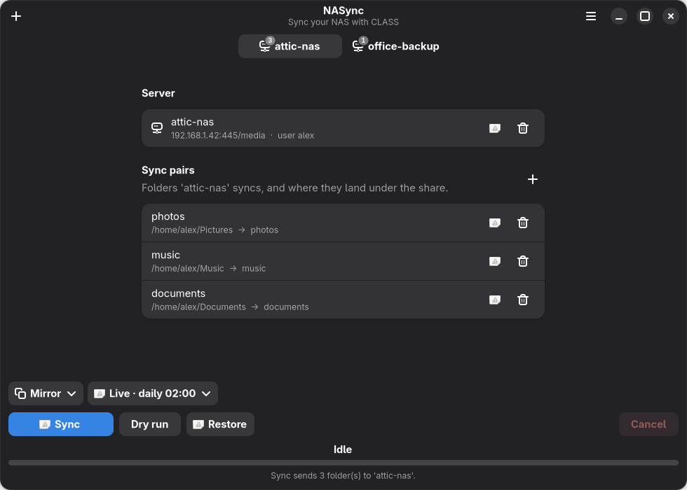
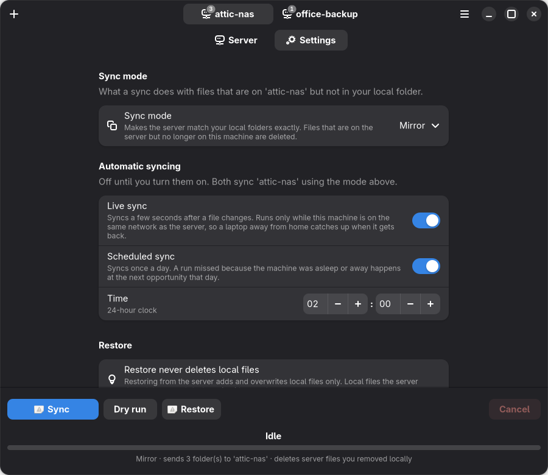
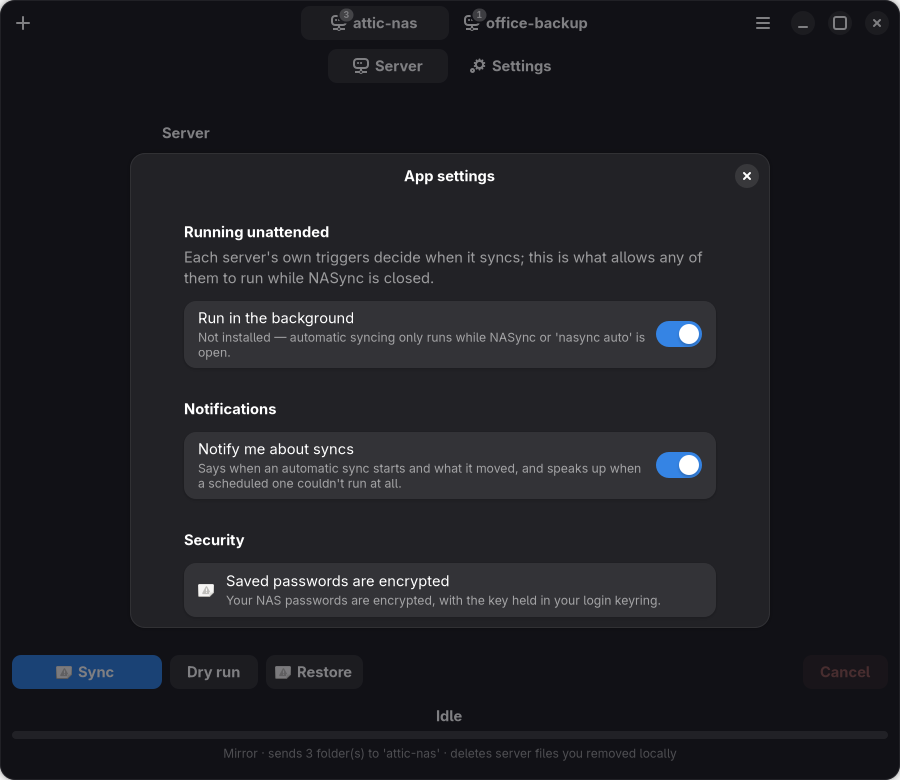
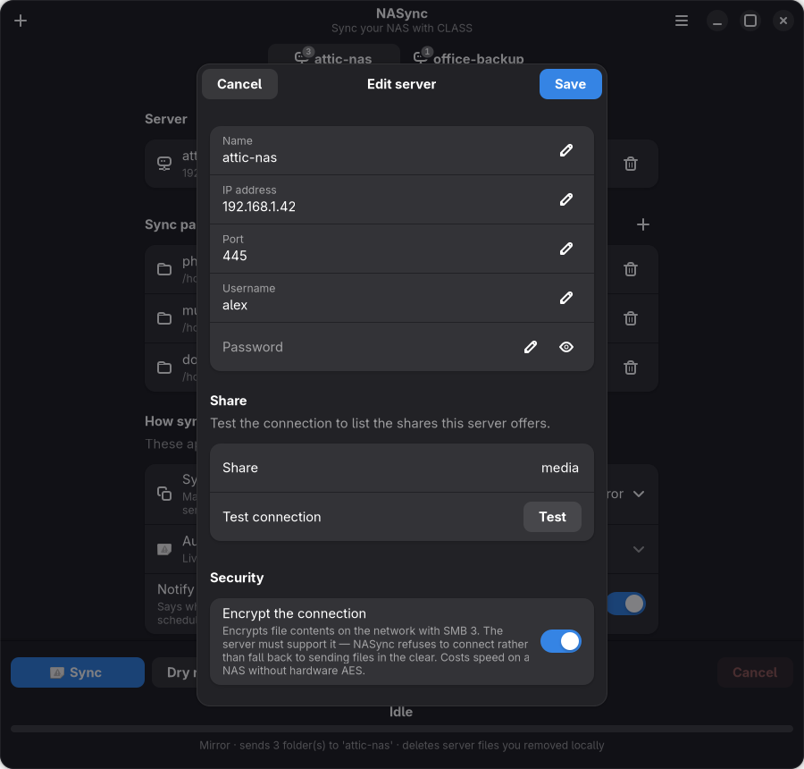

# NASync

### Sync your NAS with class.

A lightweight, cross-platform tool for syncing your local folders to a
SAMBA-based home NAS. Use it as a CLI (`nasync`), a native desktop app
(`nasync gui`), or a launcher in your desktop app menu. Perfect for simple
backup and file sync.

## Features

- 🔄 **Bidirectional Sync**: Push local changes to server or restore from backup
- 🪞 **Mirror or Update**: choose whether a sync deletes server files you removed
  locally, or only ever adds — see [Sync mode](#sync-mode)
- 🛡️ **A sync root per server**: one folder NASync may touch, so everything
  beside it is unreachable no matter how you configure a pair — see
  [The sync root](#the-sync-root)
- 🎯 **Simple Configuration**: Guided `nasync setup` with a built-in connection test
- 🖥️ **Desktop App**: A native GTK4/libadwaita window (`nasync gui`) — see [below](#desktop-app)
- ⚡ **Live sync**: sync moments after a file changes — but only on your home
  network, so a laptop away from home waits and catches up
- 🕐 **Scheduled sync**: once a day at a time you pick, catching up on runs
  missed while asleep or away
- 🔔 **Notifications**: background syncs report what they did, and a scheduled
  run that couldn't happen says so — see [Notifications](#notifications)
- 🗂️ **Browse the server**: pick a destination by looking at the share instead
  of typing a path — see [Browsing the server](#browsing-the-server)
- 📊 **See what's using space**: biggest folders first with drill-down, plus a
  duplicate finder — see [What's using space](#whats-using-space-on-the-nas)
- 🔎 **Know your server**: protocol negotiated, encryption state, free space
  and shares — see [What your server is](#what-your-server-is)
- 🔐 **Passwords encrypted at rest**: AES-GCM under a key from your keyring or
  the desktop portal, never stored by NASync itself — and on a machine with
  neither, it says so rather than implying protection it doesn't have
- 🔒 **Encrypted transfers**: optional SMB 3 encryption per server, which
  refuses to connect rather than quietly falling back to plaintext
- 🖥️ **Linux first**: Fedora, Ubuntu, Debian and friends. The CLI runs on
  macOS too; the desktop app needs GTK4 + libadwaita and so is Linux-only
- 📦 **Lightweight**: no Samba tooling to install — SMB 2/3 is spoken directly
  from Python

## Installation

### From Source

```bash
git clone https://github.com/YuvalBogo/nasync.git
cd nasync
pip install -e .
```

### Via pip (when published)

```bash
pip install nasync           # the CLI and the desktop app
```

## Quick Start

**⏱️ 5-minute setup guide:** See [QUICKSTART.md](QUICKSTART.md)

### Easiest way: guided setup

One command walks you through everything — server details with a **live
connection test**, **picking your share from an auto-detected list**, and
adding your sync folders:

```bash
nasync setup
```

That's all most people need. Prefer to configure piece by piece? The manual
steps below do exactly the same thing.

### 1. Initialize Server Configuration

```bash
nasync init
```

You'll be prompted for:
- Server IP address (e.g. `192.168.1.100`)
- SAMBA username
- SAMBA password
- Share name (default: `backup`)
- SMB port (default: `445` — press Enter unless your server uses a custom port)
- The [sync root](#the-sync-root) — the one folder on the share NASync may
  touch (default: `nasync`)

Then confirm it all works before going further:

```bash
nasync test-connection
```

This checks the server is reachable, your credentials are accepted, and the
share exists. If the share name is wrong, it lists the shares that *are*
available so you can fix it.

### 2. Add Sync Pairs

Add directories to sync. Local and server paths can have different names:

```bash
nasync add ~/Documents /docs
nasync add ~/Downloads /downloads
nasync add ~/Projects /work
```

**Pairs belong to a server**, and so do its sync mode and its automatic-sync
triggers. They're added to the active one, so each NAS has its own set of
folders and its own rules — your work NAS doesn't inherit your home NAS's
pairs, its mirror mode, or its 2am schedule. Use `--server` to file a pair
elsewhere, and `nasync list --all` to see them all. Removing a server removes
its pairs with it.

> **The server path is relative to the server's [sync root](#the-sync-root) —
> do _not_ repeat the share or root name in it.** With the share `backup` and
> the root `nasync`, passing `/docs` lands files in `backup/nasync/docs`.
> Passing `/nasync/docs` would nest them at `backup/nasync/nasync/docs`.

### 3. List Your Configuration

```bash
nasync list
```

### 4. Sync

**Push to server** (manual):
```bash
nasync sync
nasync sync --pair Documents  # specific pair
```

**Restore from server** (manual):
```bash
nasync restore
nasync restore --pair Documents
```

**Sync automatically** — see [Automatic syncing](#automatic-syncing):
```bash
nasync live-sync on                 # sync moments after a file changes
nasync scheduled-sync on --at 02:00 # and/or once a day at 02:00
```

**Watch in the foreground** (no settings changed, stops on Ctrl+C):
```bash
nasync watch
nasync watch --pair Documents  # watch a single pair
```

### 5. Manage Pairs

Remove a sync pair:
```bash
nasync remove Documents
```

## The sync root

**Each server has one folder on the share that NASync is allowed to touch.**
Every sync pair lives inside it, and nothing beside it can be reached — so a
video, a photo library or anything else sitting next to the root is safe
whatever you sync later, and whichever sync mode you pick.

```
Storage:/                        the share
├── nasync/                      ← the sync root: NASync works in here
│   ├── Documents/               a pair's destination
│   └── Pictures/                another
├── Marrige video/               ← beside the root: unreachable, always
└── old-backups/                 ← same
```

This exists because [mirror mode](#sync-mode) deletes. Without a root, what a
mirror sync could delete was "wherever the pairs happen to point" — so a folder
was protected only by the absence of a mistake, and the mistake that exposes it
(adding a pair with the wrong destination) looks entirely ordinary while you're
making it. A root turns *nothing points there* into **nothing can point
there**.

```bash
nasync root                    # show this server's root
nasync root media/nasync       # set it
nasync root --server work      # another server's
```

`nasync init` and `nasync setup` ask for it when you add a server, and the
desktop app has the same field in its server editor — and says so when a server
doesn't have one.

A pair's destination is relative to the root, so `Documents` on the root
`nasync` lands at `Storage:/nasync/Documents`. Paths that would climb out of it
(`../elsewhere`) are refused when the pair is created rather than at sync time,
and a destination of `/` means the root itself rather than the whole share.
`nasync list` and `nasync status` show where each pair actually resolves to.

> **Servers made before 0.19.0 have no root** and keep syncing exactly where
> they did, with the whole share in range as before. Set one with `nasync root
> <folder>` — the pairs' destinations stay as they are and simply become
> relative to it, so check `nasync list` afterwards.

## Sync mode

A sync always uploads new and changed files. The mode decides what happens to
files that are on the server but *not* in your local folder — typically files
you deleted locally since the last sync:

| Mode | What a sync does | Use it when |
|------|------------------|-------------|
| **Mirror** (default) | The server is made to match your local folders exactly. Server-only files are **deleted**. | The server should reflect your machine — deleting locally means deleting everywhere. |
| **Update** | New and changed files are copied. Server-only files are left alone; **nothing is deleted**. | The server is an archive that should accumulate, or you want a delete-proof backup. |

**Restore is never destructive in either mode.** Pulling from the server adds
and overwrites local files; local files the server doesn't have are left alone.

**What mirror can delete is bounded by the [sync root](#the-sync-root)** — it
only ever removes things inside that folder, so anything beside it on the share
is out of reach. Check what a switch to mirror would do before making it:

```bash
nasync sync --dry-run --mode mirror    # lists every file it would delete
```

**The mode belongs to a server**, so a NAS you mirror and one you only ever
add to are two different rules rather than one compromise. With no `--server`
these act on the active one, like `nasync add` and `nasync encryption`:

```bash
nasync mode                        # the active server's mode
nasync mode update                 # stop deleting on the active server
nasync mode mirror --server nas    # and a different rule for another
```

Override it for a single run without changing the saved default:

```bash
nasync sync --mode update    # (--no-delete is an alias for this)
nasync sync --mode mirror
```

In the desktop app it's on that server's **Settings** tab — `Mirror` or
`Update`, with a line underneath saying what the mode does to files on the
server. The line above the **Sync** button then spells out the run itself
(*Mirror · sends 3 folder(s) to 'attic-nas' · deletes server files you removed
locally*), so a run that deletes is never a surprise. A dry run
(`nasync sync --dry-run`, or **Dry run** in the app) lists exactly what would
be deleted before anything happens.

## Automatic syncing

Two independent triggers, **both off by default**, and — like the mode —
**set per server**. A home NAS can sync itself every night while a work one
never does. In the desktop app they're on that server's **Settings** tab; the
background service and notifications, which are one fact about the machine
rather than about a server, are in menu (⋯) → **App settings…**.

### Live sync

Syncs a few seconds after a file changes — the OneDrive-style behaviour.

```bash
nasync live-sync on
nasync live-sync off
nasync live-sync                    # show the active server's state
nasync live-sync on --server work   # or set it for another
```

A burst of writes (editors save the same file several times) is coalesced into
one sync, and syncs never overlap.

**Live sync only runs while this machine is on the server's network.** Away
from home the watcher keeps running and simply doesn't fire, so nothing is
attempted over a cafe network or the open internet — and coming home syncs
whatever piled up. "Same network" means the NAS is reachable without going
through a gateway; failing that, a private (RFC1918) address that answers
immediately also counts, which covers homes that split wired and wireless
across subnets. A public address never qualifies, however reachable it is.

### Scheduled sync

Syncs once a day at a set time:

```bash
nasync scheduled-sync on --at 02:00
nasync scheduled-sync --at 23:30                 # change the time
nasync scheduled-sync on --at 18:00 --server work  # a second NAS, its own slot
nasync scheduled-sync off
```

A run that couldn't happen — machine asleep, or away from home — isn't lost.
The day's sync stays due until it succeeds, so it catches up on wake or on
getting home, rather than waiting another 24 hours.

### The background service

Automation that needs the app to be open isn't automation, so turning either
trigger on arranges for `nasync auto` to run without it. There are two ways to
do that, and which one applies depends on how NASync was installed — you don't
choose it, and the same switches drive both:

| Install | Mechanism | What it means |
|:--|:--|:--|
| pip / pipx | a systemd **user** service | Starts at login; NASync can tell you whether it's running right now |
| Flatpak | the desktop's **Background portal** | Your desktop asks you once for permission, then starts NASync at login |

A Flatpak has no systemd user manager inside it, so the portal is the sandboxed
equivalent — your desktop grants the permission and owns the autostart entry.
The trade-off is that the portal has no way to be *asked* anything afterwards:
NASync can tell you it's set to start at login, but not whether it is running
at this second, and the status text says exactly that rather than guessing. You
can revoke the permission at any time in your desktop's Settings, under
**Applications ▸ NASync**.

```bash
nasync service status      # is it installed and running?
nasync service off         # pause automatic syncing entirely
nasync service on
nasync service restart
```

*Run in the background* is a switch of its own, in the Automatic popover (and
in Settings ▸ Automatic). Turning it off keeps live sync and the schedule
configured but stops anything from running them — automatic syncing pauses
rather than being reset. The desktop app shows that state as **Paused**, so
it's clear the triggers are set up and deliberately not running.

The service is also removed when you turn the last trigger off, so nothing
idles in the background. Settings changes are picked up by a running service
without a restart.

**When the service starts, it syncs only if live sync is on.** That trigger has
a real gap to fill — the file watcher only sees changes made while it's
running, so edits made while the service was down need catching up. A
schedule-only setup has no such gap: it has a slot, and a missed one already
catches up on its own. Changing a setting restarts the service, and a setting
whose purpose is to defer work until 2am should not cause a full sync at 3pm.
Override it either way with `nasync auto --sync-at-start` /
`--no-sync-at-start`.

**A scheduled sync counts as done only if at least one folder actually
synced.** If every folder fails — the share was renamed, permissions changed,
an external disk isn't mounted — the day's run stays due and is retried every
15 minutes, and you're told once that it didn't happen. A partial success does
count, so one folder on an unmounted disk can't keep re-syncing all the healthy
ones.

A user service stops when you log out. To keep syncing across logouts:

```bash
loginctl enable-linger $USER
```

That one is a systemd concern only — under a Flatpak the desktop owns the
autostart entry and there's no lingering to enable.

With neither mechanism available, the settings still save and still apply while
NASync or `nasync auto` is running — the app says as much instead of pretending.

### Notifications

A background sync that says nothing is indistinguishable from one that isn't
running, so automatic syncs announce themselves on the desktop: when a sync
starts, what it moved when it finished, and — at critical urgency, so it
survives Do Not Disturb — when a scheduled run **couldn't happen at all**.
That last one is the failure worth knowing about; the others are reassurance.

```bash
nasync notifications          # show the current state
nasync notifications off
nasync notifications --test   # send one now, and name the backend used
```

On by default. A run's "started" notification is replaced in place by its
"finished" one, so a machine syncing all day occupies a single notification
rather than a growing pile, and a scheduled run that keeps failing says so
once rather than once a second.

Notifications go through your desktop's notification portal inside a Flatpak,
and `gdbus` (part of glib2) or `notify-send` elsewhere. `nasync notifications
--test` names which one it used.

**One notification per burst, not per file.** Live sync fires once per lull in
file activity, so copying a folder in runs several syncs; their results are
batched and reported together once things settle, rather than one banner per
run.

**A sync that changed nothing doesn't notify.** A run reports when it moved
files, removed them, or hit errors, and a scheduled run that couldn't happen
at all still speaks up at critical urgency — but a daily "0 transferred" would
only train you to ignore the one message that matters. `nasync status` says
what automatic syncing is doing whenever you want to check. On a machine with none of them — a headless
server, a locked-down container — syncing carries on exactly as before,
silently.

#### When notifications don't appear

`nasync notifications --test` sends one immediately and names the transport it
used. If it reports success and nothing appears, the notification is being
accepted and then discarded — which a desktop does silently, so nothing in
NASync's own output will say so. Watch the bus to see what happens to it:

```bash
dbus-monitor --session "interface='org.freedesktop.Notifications'"
```

A `NotificationClosed` signal arriving milliseconds after the `Notify` call
means the shell threw it away. That is what GNOME Shell 50 did to every
notification carrying a `desktop-entry` hint, which NASync no longer sends —
see 0.18.1 in the changelog.

For a background sync that failed with an unhelpful message, run the service
with tracebacks turned on:

```bash
systemctl --user edit nasync-auto.service   # add: Environment=NASYNC_DEBUG=1
```

### Moving from pip to the Flatpak

A Flatpak keeps its config inside `~/.var/app/`, so it doesn't look where a pip
or pipx install put yours. The first time the Flatpak runs it imports
`~/.config/nasync` if it finds one — servers, folders and saved passwords — and
tells you it did.

It **copies**, so your pip install keeps working and nothing is lost if you go
back. It only ever runs when the Flatpak has no settings of its own, so it
can't overwrite anything you set up there.

## Desktop app

A native GTK4 + libadwaita window that follows your system light/dark theme:

```bash
nasync gui
```



Servers are tabs in the header, each owning its own sync pairs *and* its own
sync mode and triggers, so a tab is the whole context for a sync. Under it,
**Server** holds that NAS and its folders and **Settings** holds how it syncs —
stated with their current values rather than hidden behind a menu, because
this is an app you configure once and afterwards open to check on.

| | |
|:--|:--|
|  |  |
| **Settings**, per server — its sync mode and its own triggers | **Storage** — what's using space, biggest first, with drill-down |
|  |  |
| **App settings** — the background service, notifications, and how your passwords are stored | **Editing a server** — with a live connection test and the share list |

It's a front-end over the same engine as the CLI:

- **A tab per server** — switching tabs switches the active server, and each
  tab holds only that server's sync pairs. The tab badge counts them. Add or
  edit a server in a dialog that can test the connection and fill the share
  list from the server itself.
- **Sync pairs** — local→server mappings, listed on the page with a real
  folder picker behind the **+** beside the group's title
- **A Settings tab per server** — that server's sync mode and its own live
  and scheduled triggers, stated with their current values: `Mirror` with a
  line saying what mirror does to server files, and the triggers that decide
  whether it syncs by itself. What a sync deletes and whether one happens
  unattended are the two things worth seeing without going looking.
  App-wide settings — the background service, notifications and password
  security — are in menu (⋯) → **App settings…**.
- **Sync / Dry run / Restore** pinned to the bottom, with **Cancel** at the
  far end of the same row, and the transfer state directly beneath them
- **Progress for the pair being synced**, with the state (Idle, Syncing…,
  Complete) centred above the bar and the detail — which pair, which file,
  bytes, elapsed — below it. The bar accounts for progress *within* the
  current file, so one large file still moves it. The last line says what the
  run will do before you start it, and what it did once finished.
- Files that fail individually are counted and listed under **Show errors**,
  rather than disappearing into a success message
- **Notifications for syncs you aren't watching** — switch away mid-transfer
  and the result comes to you instead of waiting on screen

### Building the Flatpak

The desktop app is packaged for Flatpak, which carries its own GTK4 and
libadwaita — so it runs on distributions too old to have them, which is what
makes it the answer for Ubuntu 22.04, Debian 12 and Fedora 39.

```bash
flatpak install -y flathub org.gnome.Platform//50 org.gnome.Sdk//50
flatpak-builder --user --install --force-clean build \
    packaging/io.github.YuvalBogo.NASync.yml
flatpak run io.github.YuvalBogo.NASync
```

It is not on Flathub yet. See [`packaging/README.md`](packaging/README.md) for
how the dependency pinning works and what a submission would need.

### Installing the dependencies

PyGObject, GTK4 and libadwaita are system packages, not pip installs.

**Fedora** (40 and newer):

```bash
sudo dnf install python3-gobject gtk4 libadwaita
pipx install --system-site-packages \
  git+https://github.com/YuvalBogo/nasync.git
```

**Ubuntu** (24.04 LTS and newer) **/ Debian 13+**:

```bash
sudo apt install python3-gi gir1.2-gtk-4.0 gir1.2-adw-1 pipx
pipx install --system-site-packages \
  git+https://github.com/YuvalBogo/nasync.git
```

Then add the app to your menu:

```bash
nasync install-desktop
```

**Why `--system-site-packages`:** GTK can't be installed by pip, so it lives in
the system Python. A normal venv (and a normal `pipx install`) hides it, and
`nasync gui` will stop and tell you so. The flag lets the isolated install see
GTK while keeping nasync's own dependencies separate. Same reason applies to a
manual venv: `python -m venv --system-site-packages .venv`.

> On Ubuntu, a bare `pip install` is blocked by PEP 668
> ("externally-managed-environment"). `pipx` is the supported route and is what
> the commands above use.

**Requires libadwaita 1.5 or newer**, which is what the dialogs are built on:

| Distro | libadwaita | Desktop app |
|---|---|---|
| Fedora 40+ | 1.5+ | ✅ |
| Fedora 39 | 1.4 | ❌ — use the CLI, or the Flatpak |
| Ubuntu 24.04 LTS+ | 1.5+ | ✅ |
| Ubuntu 22.04 LTS | 1.1 | ❌ — use the CLI, or the Flatpak |
| Debian 13+ | 1.6+ | ✅ |
| Debian 12 | 1.2 | ❌ — use the CLI, or the Flatpak |

On anything older, `nasync gui` reports the version it found and says what to
do about it, rather than failing partway through a widget. The Flatpak is the
real answer there — it carries its own runtime, so the desktop app runs
regardless of what the distribution ships. The desktop app is Linux-oriented;
on macOS, use the `nasync` commands.

### Launch it like an app (Linux)

Add nasync to your desktop application menu with an icon:

```bash
nasync install-desktop
```

Then find **NASync** in your app launcher, with the project logo. It opens the
desktop app directly. If GTK4 and libadwaita 1.5+ aren't available the command
refuses rather than installing an entry that opens nothing — a launcher in your
apps list that does nothing is worse than no launcher at all.

This installs a standard freedesktop `.desktop` entry and an icon under
`~/.local/share` (nothing system-wide, no root needed). Both are named after
the application ID, `io.github.YuvalBogo.NASync`, which is what lets GNOME
match the running window to the launcher and show the logo in the dash and
alt-tab instead of a generic icon. To remove it:

```bash
nasync install-desktop --uninstall
```

> Install the GTK packages *before* running `install-desktop`; it checks for
> them and refuses without them.

> On macOS there's no `.desktop` mechanism — use the `nasync` commands.

## Configuration

Configuration is stored in:
- **Linux/macOS**: `~/.config/nasync/config.json`
- **Credentials**: `~/.config/nasync/.creds` (mode 0600, encrypted — see below)

### Encrypting the connection

By default NASync signs its traffic but does not encrypt it: signing proves
nobody tampered with your files in transit, encryption is what stops anyone
reading them. Turn encryption on per server:

```bash
nasync encryption on              # the active server
nasync encryption on --server nas # a specific one
nasync encryption                 # show the current setting
nasync test-connection            # check it before the next scheduled run
```

There is a switch in the desktop app's server editor too.

| | |
|:--|:--|
| **What it protects** | The contents of your files on the network, with AES-GCM |
| **What it needs** | SMB 3 at both ends — most NAS boxes made since ~2014 |
| **What it costs** | Throughput. On a NAS with no hardware AES it can halve transfer speed |
| **Default** | **Off**, so that upgrading NASync never breaks a working setup |

**If your server can't encrypt, NASync refuses to connect** rather than falling
back to sending your files in the clear. A security setting that silently
degrades is worse than no setting at all, because it reads as protection that
isn't there. You'll get a message saying the server needs SMB 3 and how to
carry on without encryption — not a protocol error about "the connection".

Worth turning on if you sync over Wi-Fi, on a network you share with people you
don't administer, or over a VPN link you don't control. Less obviously worth it
on a wired LAN in your own home, where the cost is real and the threat is not.

### How your NAS passwords are stored

Passwords are never written to `config.json`. They live in `.creds`, which
since 0.11.0 is **encrypted with AES-GCM** under a key NASync does not store
itself:

| Where NASync is installed | Where the key lives |
|:--|:--|
| Flatpak | Held for the app by `org.freedesktop.portal.Secret` |
| pip / pipx / source | One item in your login keyring, shown in Seahorse as *NASync credential key* |
| No keyring or portal at all | **Nowhere — the file stays plaintext at mode 0600** |

That last row is the honest case, not a bug: a headless box or an SSH session
with no session bus has nowhere to keep a key. NASync keeps working there, and
`nasync status` says which of the three you have rather than implying a
protection you don't:

```bash
nasync status | grep "Saved passwords"
#   Saved passwords: encrypted (key held in your keyring)
```

An existing plaintext `.creds` is encrypted in place the next time NASync
starts. Nothing is asked of you and no password needs re-entering.

> **Moving a pip install to the Flatpak?** Servers, folders and pairs come
> across automatically, but **passwords do not** — the host's key is in your
> keyring and the sandbox's is held by the portal, so a file sealed by one
> genuinely cannot be opened by the other. NASync tells you that is what
> happened; enter each password once in the Flatpak and you're done.

If your keyring is locked when NASync starts, it says so instead of trying to
connect without a password and letting the NAS report a login failure — the
symptom that would otherwise send you to re-check a password that was right all
along.

Example config structure:
```json
{
  "servers": [
    {
      "name": "home-nas",
      "ip": "192.168.1.100",
      "username": "backup_user",
      "share": "backup",
      "port": 445
    }
  ],
  "active_server": "home-nas",
  "pairs": [
    {
      "name": "Documents",
      "local": "/home/user/Documents",
      "server": "/docs"
    }
  ]
}
```

### Understanding server paths

A pair's `server` path is **relative to the root of the SMB share**, not an
absolute path on the server's filesystem. Think of the share as the top level.

With share `backup` mounted at, say, `/srv/samba/backup` on the server:

| `share`  | pair `server` path | Ends up on the server as        |
|----------|--------------------|---------------------------------|
| `backup` | `/docs`            | `backup/docs` → `/srv/samba/backup/docs`  |
| `backup` | `/photos/2024`     | `backup/photos/2024`            |
| `backup` | `/backup/docs` ⚠️   | `backup/backup/docs` (double-nested — usually a mistake) |

So the share name comes from `nasync init`; the `server` path in each pair
is just where *inside* that share the files should go.

### What your server is

```bash
nasync server-info
```

```
🖥️  nas  (192.168.1.50:445, user alex)

  Connection
    Protocol:    SMB 3.1.1
    Encrypted:   no  (this server supports it — 'nasync encryption on')
    Signed:      yes
    Max read:    8.0 MB

  Storage
    Free:        21.9 GB of 91.2 GB (76% used)

  Shares
    ● backup           Disk
      media            Disk
      IPC$             IPC       (administrative)
```

In the desktop app it's **Server info…** in the menu.

Everything here comes from the **live connection**, not from your settings —
the settings say what was asked for, only the connection knows what the server
agreed to. A NAS that quietly negotiated an older protocol, or a session that
isn't encrypted although you turned encryption on, shows up here.

It's read-only and speaks only standard SMB, so it reads the same on a
Synology, a TrueNAS box or a Raspberry Pi running Samba. **NASync deliberately
doesn't change server settings** — your NAS's own web interface does that
better, and doing it here would mean a different code path per manufacturer.

### What's using space on the NAS

```bash
nasync usage              # the whole share, biggest folders first
nasync usage movies       # drill into one
nasync duplicates         # files stored more than once
```

```
📊 backup:/ — 22.8 MB in 7 file(s)
   Disk: 22.1 GB free of 91.2 GB (76% used)

   ██████████   11.4 MB  movies/
   ████████░░    8.6 MB  backups/
   █░░░░░░░░░    1.4 MB  photos/
```

Each folder is ranked by everything **beneath** it, so a big file three levels
down is attributed to the folder you'd actually delete. In the desktop app it's
**Storage** in the menu, which opens on its **Usage** view.

This costs a scan and nothing more — it reuses the same index the sync engine
builds, which reads one directory per round trip.

**Free space** is shown as what *you* may still write, not the disk's raw free
space: on a NAS with per-user quotas those differ, and the disk's figure
promises room a sync can't actually use. When they differ, both are shown.

#### Duplicates

Grouping by size is free, because the scan already knows every size. Confirming
by content is not — SMB has no server-side hash, so verifying means reading
every candidate over the network:

```bash
nasync duplicates                    # by size; costs nothing extra
nasync duplicates --verify           # confirms by content, tells you the cost first
nasync duplicates --min-size 100000  # default floor is 1 MB
```

Files that share a size but differ in content are split apart by `--verify`
rather than reported together — listing them as duplicates would invite you to
delete a file that isn't a copy of anything.

In the desktop app this is the **Duplicates** view in **Storage**, beside
*Usage*. Opening it reads nothing: grouping by size still means walking the
share, so it waits for **Scan for duplicates** rather than starting one
because you looked at a tab. Browsing to another folder retires the results,
which belong to the folder they were scanned in.

> **NASync never deletes anything here.** Every one of these commands is
> read-only; removing copies is your call, made with your own tools.

### Browsing the server

Rather than typing that path from memory, you can look:

```bash
nasync ls                 # the root of the share
nasync ls photos          # one directory down
nasync ls photos/2024
```

```
📂 backup:/photos
  📁 2024/
  📁 2023/
     holiday.jpg      2.4 MB
     notes.txt        120 B

   2 folder(s), 2 file(s)
```

In the desktop app there's a **Browse** button beside the destination field
when you add or edit a sync pair. It navigates one folder at a time and
selects the folder you're looking at, the way a normal folder picker does.

This matters more than a convenience: **in mirror mode, a destination pointing
at the wrong folder deletes what is in it.** Being able to see the folder
before you choose it is the cheapest protection against that, which is why the
browser reads directories rather than asking you to trust a typed path.

Two things it deliberately does *not* do:

- **It never indexes the whole share.** Each step reads one directory, so it
  stays fast on a NAS with a hundred thousand files on it.
- **Files are shown but can't be picked.** They're there so you can tell you're
  in the right folder; a sync pair's destination is always a folder.

### Using Environment Variables

For scripted/automated usage, set `SAMBA_PASSWORD`:
```bash
export SAMBA_PASSWORD="your_password"
nasync sync
```

This allows you to create cron jobs or scripts without hardcoding passwords:
```bash
#!/bin/bash
export SAMBA_PASSWORD=$(cat /path/to/secret/file)
nasync sync
```

## Commands Reference

| Command | Description |
|---------|-------------|
| `nasync setup` | Guided first-time setup (server + share + pairs) |
| `nasync gui` | Launch the native desktop app (GTK4 + libadwaita) |
| `nasync install-desktop` | Add/remove a desktop launcher + icon (Linux) |
| `nasync init` | Initialize a server (manual) |
| `nasync servers` | List saved servers |
| `nasync use <name>` | Switch the active server |
| `nasync test-connection` | Verify server, credentials, and share access |
| `nasync encryption [on\|off] [--server NAME]` | Show or set [SMB 3 encryption](#encrypting-the-connection) for a server |
| `nasync ls [PATH] [--server NAME]` | [Browse a directory](#browsing-the-server) on the server |
| `nasync server-info` | [What the server is](#what-your-server-is) and what was negotiated |
| `nasync usage [PATH]` | [What's using space](#whats-using-space-on-the-nas) on the server |
| `nasync duplicates [PATH] [--verify]` | Find [files stored more than once](#duplicates) |
| `nasync credentials [--reset]` | Show or discard [saved passwords](#how-your-nas-passwords-are-stored) |
| `nasync add <local> <server> [--server NAME]` | Add a sync pair to a server |
| `nasync list [--all] [--server NAME]` | Show a server's sync pairs |
| `nasync remove <name> [--server NAME]` | Remove a sync pair |
| `nasync sync [--pair NAME] [--mode mirror\|update]` | Incremental sync to server |
| `nasync root [PATH] [--server NAME]` | Show or set a server's [sync root](#the-sync-root) |
| `nasync mode [mirror\|update] [--server NAME]` | Show or set a server's [sync mode](#sync-mode) |
| `nasync restore [--pair NAME]` | Restore from server (never deletes locally) |
| `nasync live-sync [on\|off] [--server NAME]` | [Live sync](#live-sync) — sync moments after a file changes |
| `nasync scheduled-sync [on\|off] [--at HH:MM] [--server NAME]` | [Scheduled sync](#scheduled-sync) — sync once a day |
| `nasync service [status\|on\|off\|restart]` | Manage the [background service](#the-background-service) |
| `nasync notifications [on\|off] [--test]` | [Desktop notifications](#notifications) for automatic syncs |
| `nasync auto [--status]` | Run automatic syncing in the foreground |
| `nasync watch [--pair NAME]` | Watch and sync on changes, without saving settings |

## How It Works

- **Push (sync)** — *incremental*: only new or changed files are uploaded, and
  unchanged files (matched by size) are skipped. Whether files removed locally
  are also removed on the server depends on the [sync mode](#sync-mode):
  **mirror** (default) deletes them, **update** keeps them.
- **Pull (restore)**: downloads files from the server that are missing or
  differ locally. It never deletes local files, in either mode.
- **Automation**: [live sync](#live-sync) reacts to file changes (only on the
  server's network) and [scheduled sync](#scheduled-sync) runs once a day, both
  in whichever sync mode is set, run by a systemd user service
- **Local is source of truth**: the server follows the local folders

### Architecture: how it talks to the server

nasync speaks the **native SMB/CIFS protocol** — the same one your file
manager uses for `smb://192.168.1.100/`. It does **not** use SSH and it does
**not** shell out to any external tool: it talks SMB 2/3 directly from Python
via [`smbprotocol`](https://github.com/jborean93/smbprotocol).

```
nasync (Python)
   └─ smbprotocol                      (pure-Python SMB 2/3 client)
        └─ SMB/CIFS over TCP port 445  →  your server's Samba share
```

Details worth knowing:

- **One connection per sync.** A session is negotiated once and reused for
  every file in the run, not reopened per file, which keeps large directory
  trees fast.
- **Comparing costs one request per directory, not per file.** Working out what
  changed is the part of a sync you actually wait through, and every sync pays
  it — including the ones with nothing to do. Each file's size arrives in the
  directory listing, so nasync reads it there rather than asking the server
  about each file in turn: a 3,000-file share is 121 requests instead of 3,241.
- **Transfers move in 1 MiB chunks**, which is what makes per-byte progress
  and mid-transfer cancellation possible.
- **Port** is whatever you configured (default `445`).
- **Containers are transparent.** If your server runs Samba in Docker, nasync
  just connects to the host's published `IP:445` — exactly like your file
  manager. It neither knows nor cares that a container is behind it.

**Why this design:**

- ✅ **No external binary** — nothing to install beyond `pip install nasync`,
  and it works inside a Flatpak sandbox, where `smbclient` isn't present
- ✅ **Cancellable, with real progress** — a running sync can be stopped
  between chunks, and a single large file reports smooth progress instead of
  jumping 0% → 100% on completion
- ✅ **Arbitrary filenames** — quotes and newlines work, where the old
  subprocess backend had to reject them as unescapable
- ⚠️ Trade-off: SMB is now a Python dependency rather than a system one, so
  protocol fixes arrive by upgrading the package

> Earlier releases drove the system `smbclient` binary as a subprocess and
> scraped its output. That backend is gone; the wire protocol is unchanged,
> only our side of the conversation is different.

## Requirements

- Python 3.10+
- A SAMBA share accessible on your network, with read/write permissions
- No external SMB tooling — `smbprotocol` is installed by pip and speaks SMB
  2/3 directly

Optional, per front-end:

- **Desktop app** (`nasync gui`): PyGObject + GTK4 + libadwaita, which are
  system packages — see [Desktop app](#desktop-app)

## Testing

No NAS needed — `scripts/local-test.sh` spins up a throwaway Samba server in a
container (podman or docker), runs a full push → verify → restore → dry-run
cycle against it in an isolated config, and tears everything down afterwards:

```bash
pip install -e .
./scripts/local-test.sh          # full end-to-end test
KEEP=1 ./scripts/local-test.sh   # leave the server/config up to poke at
```

Pure-logic unit tests (no server required):

```bash
python -m pytest            # the whole suite
python -m pytest tests/test_samba.py -v
```

## How the code is laid out

```
nasync/
  core/       the engine — nothing here knows which front-end is calling
    config.py       config.json + the encrypted .creds under ~/.config/nasync
    samba.py        SMB 2/3: indexing, transfers, browsing, usage reports
    sync.py         Syncer — compares two trees and moves what differs
    automation.py   the live and scheduled triggers, and the loop running them
  system/     how NASync fits the machine it runs on
    portal.py       XDG Desktop Portal — Background, Notification, Secret
    service.py      background syncing: a systemd user unit, or the portal
    notify.py       desktop notifications
    vault.py        encrypts saved passwords, keyed from the portal or keyring
    lan.py          "is the NAS on this network?" — the gate on automatic syncing
    launcher.py     the .desktop entry and icon
  gui/        the desktop app (GTK4 + libadwaita)
  cli.py      the command line — the reference surface for every feature
  format.py   presentation helpers both front-ends share
tests/        one file per module
```

`core/` depends on nothing above it. `system/` is the part that decides which
permissions a Flatpak build has to ask for, which is why it's grouped rather
than scattered. `cli.py` and `gui/` are two callers of the same engine — a
feature isn't done until it exists in both.

## Contributing

Contributions welcome! Please feel free to submit issues or pull requests.

## License

MIT License

## Common Use Cases

### Automatic syncing in the background

Turn on [live sync or scheduled sync](#automatic-syncing) and the systemd user
service is installed for you — no unit file to write:

```bash
nasync live-sync on
nasync scheduled-sync on --at 02:00
nasync service status
```

To keep it running after you log out (rather than only while logged in):

```bash
loginctl enable-linger $USER
```

If you'd rather not use the service at all, `nasync auto` runs the same thing
in the foreground, and `cron` can still call `nasync sync` directly:

```bash
0 2 * * * /usr/bin/nasync sync
```

### Multi-Directory Sync

Sync different directories on different schedules:

```bash
# Sync everything at once
nasync sync

# Sync only Documents (faster for quick backups)
nasync sync --pair Documents

# Restore only Downloads if needed
nasync restore --pair Downloads
```

## Acknowledgments

Built with:
- [Click](https://click.palletsprojects.com/) - CLI framework
- [watchdog](https://github.com/gorakhargosh/watchdog) - File system monitoring
- [appdirs](https://github.com/ActiveState/appdirs) - Platform-specific paths
