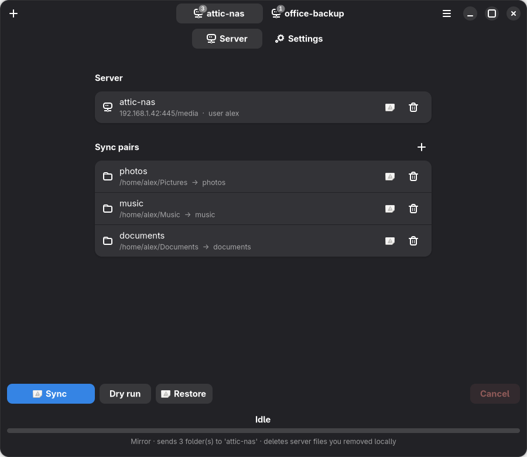
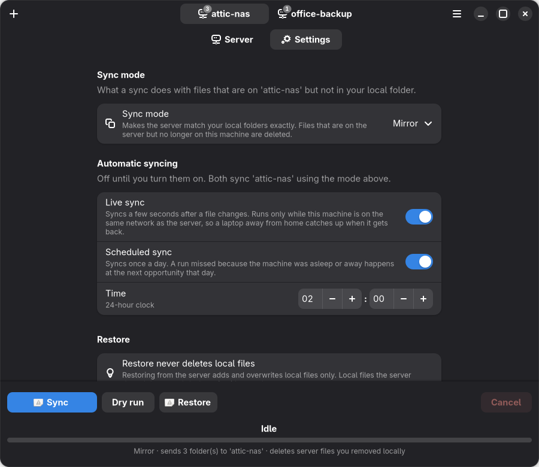
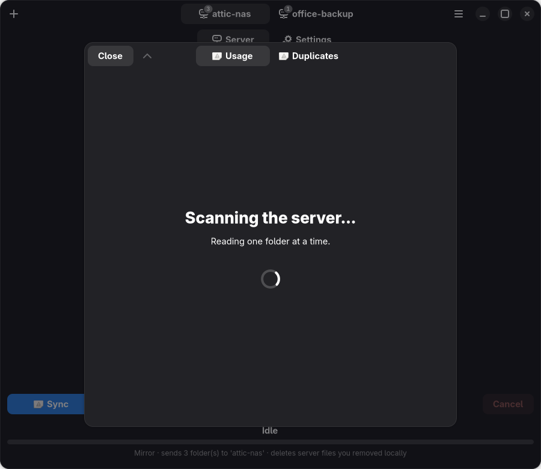
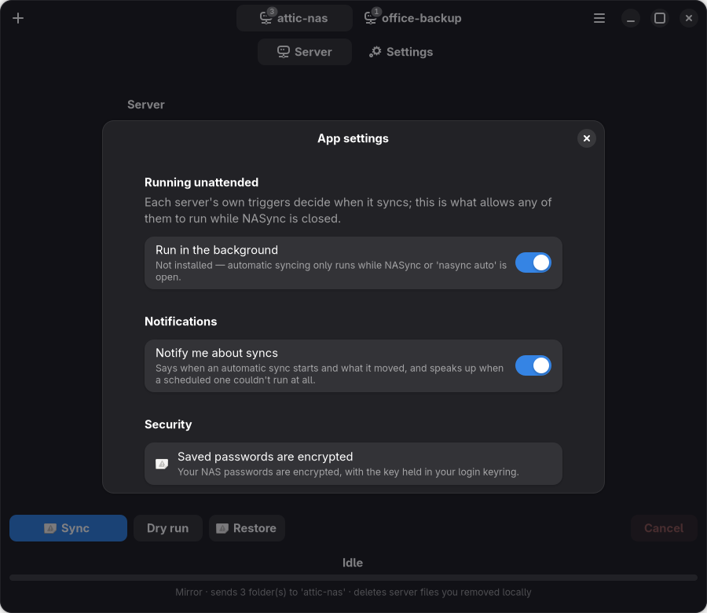
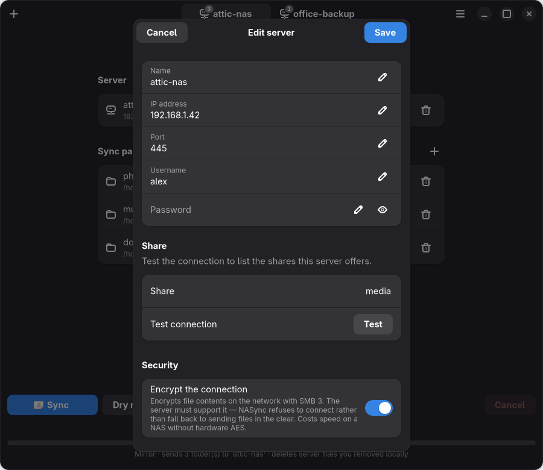

# Desktop app

A native GTK4 + libadwaita window that follows your system light/dark theme.
Open it from your app menu (after `nasync install-desktop`, see
[Installation](install.md#add-it-to-your-app-menu)) or with:

```bash
nasync gui
```



It's a front-end over the same engine as the `nasync` command, so anything
described elsewhere in these docs works the same in both.

Servers are tabs in the header, each owning its own sync pairs *and* its own
sync mode and triggers, so a tab is the whole context for a sync. Under it,
**Server** holds that NAS and its folders and **Settings** holds how it syncs —
stated with their current values rather than hidden behind a menu, because
this is an app you configure once and afterwards open to check on.

| | |
|:--|:--|
|  |  |
| **Settings**, per server — its sync mode and its own triggers | **Storage** — what's using space, biggest first, with drill-down |
|  |  |
| **App settings** — the background service, notifications, and how your passwords are stored | **Editing a server** — with a live connection test and the share list |

## Around the window

- **A tab per server.** Switching tabs switches the active server, and each
  tab holds only that server's sync pairs; the tab badge counts them. Add or
  edit a server in a dialog that tests the connection and fills the share
  list from the server itself.
- **Sync pairs** — local→server mappings, with a real folder picker behind
  the **+** beside the group's title, and a **Browse** button that looks at
  the server's folders instead of making you type a path (see
  [Server tools](server-tools.md#browsing-the-server)).
- **Settings, per server** — that server's sync mode and its live and
  scheduled triggers, stated with their current values: `Mirror` with a line
  saying what mirror does to server files, and the triggers that decide
  whether it syncs by itself. What a sync deletes and whether one happens
  unattended are the two things worth seeing without going looking.
- **App settings** — the background service, notifications and password
  security, in menu (⋯) → **App settings…**.
- **Sync / Dry run / Restore** pinned to the bottom, with **Cancel** at the
  far end of the same row, and the transfer state directly beneath them.
- **Progress for the pair being synced**, with the state (Idle, Syncing…,
  Complete) above the bar and the detail — which pair, which file, bytes,
  elapsed — below it. The bar counts progress *within* the current file, so
  one large file still moves it. The last line says what the run will do
  before you start it, and what it did once finished.
- **Errors aren't swallowed.** Files that fail individually are counted and
  listed under **Show errors**, rather than disappearing into a success
  message.
- **Background syncs are visible.** A sync started by the background service
  shows in the window with its progress and a **Cancel** button (see
  [One sync at a time](automation.md#one-sync-at-a-time)).
- **Notifications for syncs you aren't watching** — switch away mid-transfer
  and the result comes to you instead of waiting on screen.
- **Server info…** and **Storage** are in the menu (see
  [Server tools](server-tools.md)).
